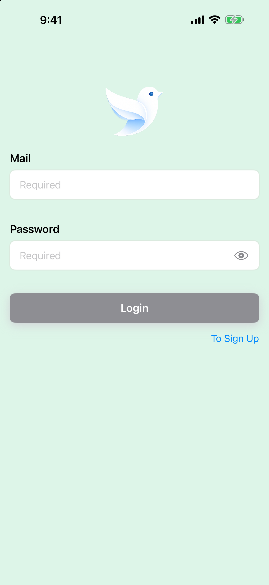
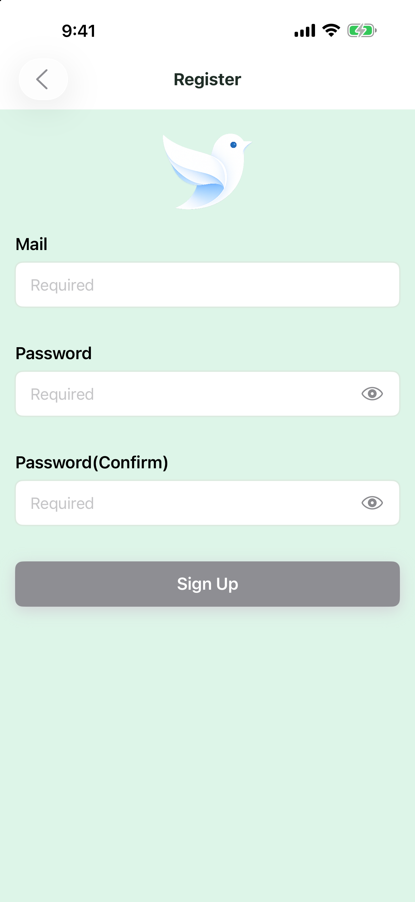
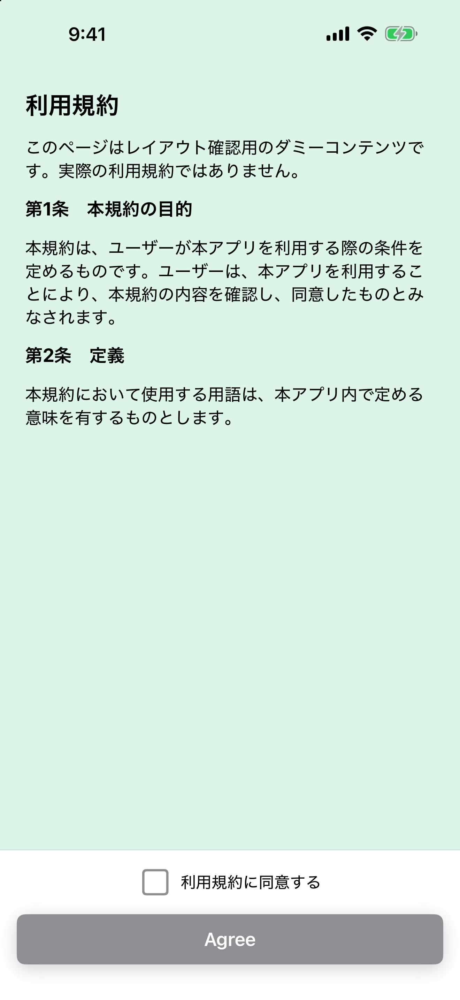
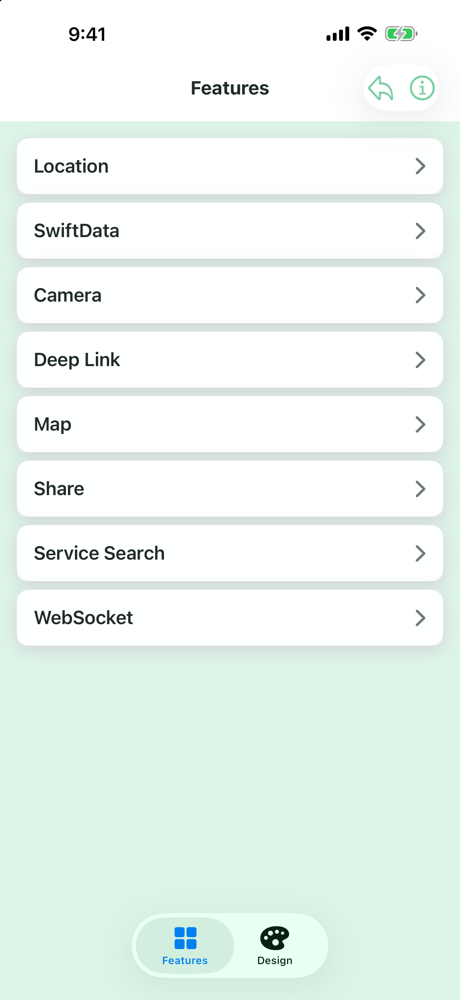

# PortfolioMobileiOS

[](https://github.com/JunpeiAbe/PortfolioMobileiOS/actions/workflows/unit-tests.yml)

SwiftUIで実装したポートフォリオ用iOSアプリです。  
ログイン、新規登録、利用規約同意、ホーム、通知一覧、機能一覧、詳細画面など、実務アプリで頻出する画面遷移と状態管理を一通り確認できる構成にしています。

## Screenshots

| Login | Register | Terms |
|---|---|---|
|  |  |  |

| Features |
|---|
|  |

Debug用スクリーンショットは、iPhone Simulatorを起動してから次のコマンドで再生成できます。

```shell
./Scripts/capture_readme_screenshots.sh
```

## 主な機能

- 認証機能: ログイン、新規登録、セッション復元、ログアウト
- アプリ起動制御: メンテナンス判定、強制アップデート判定、利用規約同意
- メイン機能: ホーム、お知らせ、機能一覧、詳細
- プッシュ通知: Firebase Cloud Messagingによる通知トークン連携
- 開発環境: Debug / Staging / Releaseの環境切り替えとスタブレスポンス対応

## 技術スタック

- Swift 6.0 / SwiftUI
- Swift Testing
- Swift Concurrency / Observation
- URLSession / Keychain / UserDefaults
- Firebase Messaging

## Unit Test

Swift Testingを使用し、Validation、API Request、API Client、永続化、Repository、Store、画面状態、Navigationをテストしています。入力値の境界条件はParameterized Testにまとめ、各テストには検証内容が分かるコメントを記載しています。

GitHub Actionsにより、`master`へのpushとPull Requestの作成・更新時にUnit Testを自動実行します。必要に応じてActions画面から手動実行することもできます。

テストコードはプロダクションコードに対応したディレクトリ構成で、`PortfolioMobileiOSTests/` 以下に配置しています。テストケースの一覧は [Unit Testケース一覧](docs/unit-test-cases.md) を参照してください。

Xcodeから`Debug` SchemeのUnit Testを実行するか、次のコマンドで実行できます。

```shell
xcodebuild -project PortfolioMobileiOS.xcodeproj \
  -scheme Debug \
  -configuration Debug \
  -destination 'platform=iOS Simulator,name=iPhone 17 Pro Max' \
  -only-testing:PortfolioMobileiOSTests \
  test
```

## アーキテクチャ

SVVSを採用し、画面表示、画面状態、アプリ状態、データ取得の責務を分離しています。

- `Screen`: 画面単位のSwiftUI View
- `ViewState`: 画面ごとの状態管理と画面イベントの処理。本プロジェクトでは `*ScreenState` として実装
- `Store`: 複数画面で共有する状態とユースケースの集約
- `Service / Repository`: API通信、永続化、外部サービス連携

依存関係は `AppDependency` で生成し、Debug / Staging / Releaseごとに差し替えられるようにしています。  
これにより、実API接続前でもスタブレスポンスで画面確認でき、API ClientやRepositoryもテストしやすい構成にしています。

詳細は [アーキテクチャ説明](docs/architecture.md) に記載しています。

## ディレクトリ構成

```text
PortfolioMobileiOS/
├── App/                 # アプリ起動、依存関係、Root画面
├── BuildConfiguration/  # Debug / Staging / Release のxcconfig
├── Constants/           # 定数、エラー、表示文言
├── Data/                # API、DB、Repository実装、Push通知
├── Domain/              # Model、Repository Protocol、Validation
├── Extensions/          # Swift / SwiftUI 拡張
├── Navigation/          # 画面遷移、タブ、アラート
├── Resources/           # Asset、StubResponse、WebContents
├── Screens/             # 各画面のViewとState
├── Stores/              # アプリ状態とユースケース
└── ViewComponents/      # 共通UIコンポーネント
```

## 起動方法

1. `PortfolioMobileiOS.xcodeproj` をXcodeで開く
2. Firebase Messagingを利用する場合は `GoogleService-Info.plist` を自身のFirebase設定に置き換える
3. Schemeを `Debug`、`Staging`、または `PortfolioMobileiOS` から選択する
4. iOS Simulatorまたは実機でRunする

Debug Schemeではスタブレスポンスを利用するため、バックエンドAPIが未接続でも主要画面の確認ができます。

## 今後の改善候補

- APIエラーごとのユーザー向けメッセージ最適化
- UI Testの追加
- デザインシステムとしてのUIコンポーネント整理
